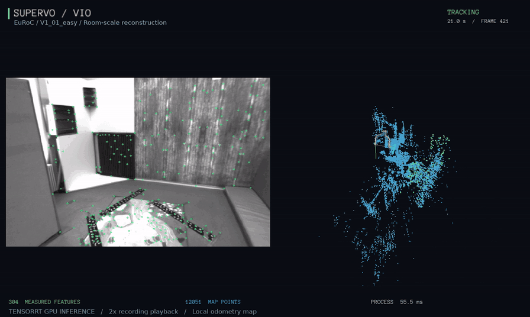
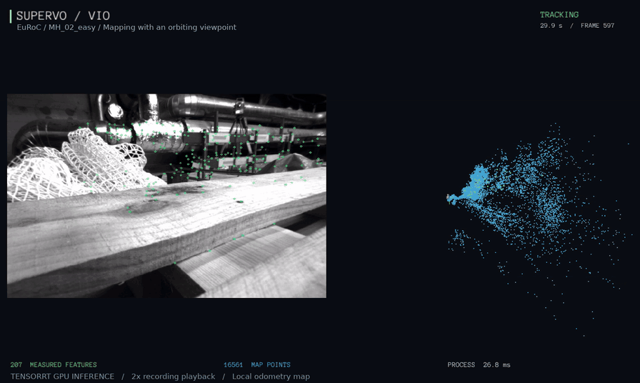
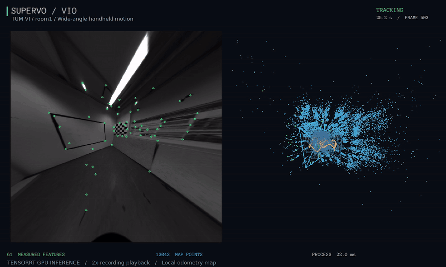

# SuperVO / SuperVIO

基于 SuperPoint 的 C++17 双目视觉与视觉惯性里程计，支持 EuRoC、KITTI 和 TUM VI，
提供 CPU / TensorRT 推理、Pangolin 可视化和轨迹输出。

## 效果展示



| EuRoC 机库建图与环绕视角 | TUM VI 手持运动跟踪 |
|---|---|
|  |  |

真实 GPU 运行录屏，按 2 倍录屏速度播放；[素材说明](assets/README.md)。

## EuRoC 评测

以下为已验收算法版本 `55181a1` 的归档结果：TensorRT GPU FP32、无回环，
`window` + `uniform` + `resolve`，10 状态 / 300 地标，主求解最多 6 次迭代。
11 条序列各运行三轮，指标取三轮中位数；ATE 宏平均对序列等权计算。
按原始左目相机坐标系评分，使用 SE(3) 对齐，尺度固定为 1。
ATE 为平移 RMSE（m）；RPE 为对应时间间隔的平移 / 旋转 RMSE（m / °）。

| 序列 | ATE（m） | 1 s RPE（m / °） | 5 s RPE（m / °） | 10 s RPE（m / °） |
|---|---:|---:|---:|---:|
| MH_01_easy | 0.0447 | 0.0124 / 0.622 | 0.0396 / 1.196 | 0.0545 / 1.520 |
| MH_02_easy | 0.0421 | 0.0100 / 0.755 | 0.0270 / 1.291 | 0.0430 / 1.456 |
| MH_03_medium | 0.0745 | 0.0298 / 0.643 | 0.0948 / 0.720 | 0.1230 / 0.842 |
| MH_04_difficult | 0.1126 | 0.0321 / 0.773 | 0.1013 / 1.719 | 0.1628 / 2.014 |
| MH_05_difficult | 0.0960 | 0.0270 / 0.722 | 0.0828 / 1.582 | 0.1513 / 2.297 |
| V1_01_easy | 0.0498 | 0.0430 / 0.645 | 0.1682 / 2.363 | 0.2541 / 3.458 |
| V1_02_medium | 0.0424 | 0.0358 / 0.627 | 0.1003 / 1.219 | 0.1395 / 1.272 |
| V1_03_difficult | 0.0687 | 0.0337 / 0.432 | 0.0986 / 1.110 | 0.1226 / 1.733 |
| V2_01_easy | 0.0521 | 0.0187 / 0.671 | 0.0516 / 1.651 | 0.0791 / 2.150 |
| V2_02_medium | 0.0682 | 0.0215 / 0.557 | 0.0604 / 1.255 | 0.0902 / 1.768 |
| V2_03_difficult | 0.1339 | 0.0283 / 0.790 | 0.0764 / 1.946 | 0.1152 / 2.138 |

**ATE 宏平均 0.07136 m，完成 33/33 次。**
归档评测机上的合计墙钟速度为 20.59 FPS，单帧处理耗时 p95 / p99 为
117.41 / 196.32 ms；计时关闭可视化和实时等待，速度依赖硬件与引擎构建。

## 依赖与编译

- CMake >= 3.18、C++17 编译器、Eigen >= 3.3、OpenCV 4。
- [Pangolin](https://github.com/stevenlovegrove/Pangolin)：实时可视化，默认启用。
- Ceres >= 2.1：滑窗优化。
- CUDA、TensorRT 10.x：GPU 推理。

在仓库根目录编译 GPU 滑窗版本，并生成 EuRoC 引擎：

```sh
cmake -S . -B build -DCMAKE_BUILD_TYPE=Release \
  -DSUPERVO_WITH_BA=ON -DSUPERVO_WITH_TENSORRT=ON \
  -DTENSORRT_ROOT=/path/to/TensorRT
cmake --build build -j4
build/supervo_build_engine weights/superpoint_v1.wts build/euroc.engine 752 480
```

仅使用 CPU 时省略 TensorRT 相关选项和引擎生成命令。
无界面构建可加 `-DSUPERVO_WITH_PANGOLIN=OFF`；非标准安装路径使用
`CMAKE_PREFIX_PATH` 或 `Ceres_DIR`、`OpenCV_DIR`、`Pangolin_DIR` 指定。
更多安装说明见 [构建文档](docs/BUILD.md)。

## 使用

`superVO` 使用双目视觉，`superVIO` 默认启用 IMU。以下命令均从仓库根目录执行。

### EuRoC：GPU 双目惯性滑窗与可视化

```sh
build/superVIO --dataset /path/to/EuRoC/sequence \
  --backend tensorrt --engine build/euroc.engine \
  --estimator window --observation-noise uniform --window-feedback resolve \
  --viewer --realtime --output results/vio
```

窗口显示左目图像、绿色实测特征点、相机轨迹和稀疏三维地图。
鼠标拖动、滚轮调整视角，面板可暂停或切换相机跟随；输入结束后关闭窗口退出。
快捷键：`P` 简洁展示、`F` 跟随相机、`O` 地图总览、`R` 环绕视角、空格暂停。
不需要显示时省略 `--viewer --realtime`。

### CPU 双目视觉

```sh
build/superVO --dataset /path/to/EuRoC/sequence --output results/vo
build/superVO --dataset /path/to/KITTI/sequences/00 --format kitti --output results/kitti00
```

KITTI 不提供 IMU，使用 `superVO`。TUM VI 使用官方 `512_16` 导出目录，
在 VIO 命令中加 `--format tumvi`，并换用 512×512 引擎：

```sh
build/supervo_build_engine weights/superpoint_v1.wts build/tumvi.engine 512 512
```

引擎需在目标设备上生成，并匹配输入尺寸；数据目录要求见 [数据输入](docs/DATASETS.md)。

## 常用参数

只有 `--dataset` 必填。下表保留常用参数，完整选项通过 `build/superVIO --help` 查看。

| 参数 | 含义 |
|---|---|
| `--dataset PATH` | 数据集序列目录；EuRoC / TUM VI 也接受 `mav0` 目录。 |
| `--format NAME` | 输入格式：`auto`（默认）、`euroc`、`tumvi`、`kitti`。 |
| `--backend NAME` | 推理后端：`cpu`（默认）或 `tensorrt`。 |
| `--engine FILE` | TensorRT 引擎路径，GPU 模式必填。 |
| `--estimator window` | 启用紧耦合惯性滑窗，需要 IMU 和 Ceres；省略时默认使用 `eskf`。 |
| `--observation-noise uniform` | 滑窗使用统一的 1 px 观测噪声；推荐显式指定，默认是 `patch`。 |
| `--window-feedback resolve` | 清理持续离群观测后额外求解一次、最多两次迭代；推荐显式指定，默认关闭。 |
| `--viewer` | 打开 Pangolin 图像与三维地图窗口。 |
| `--realtime` | 按数据集时间戳播放，处理较慢时不会丢弃输入帧。 |
| `--output DIR` | 输出目录，默认 `results/run`。 |
| `--overwrite` | 允许覆盖已有运行输出；默认保护已有文件。 |
| `--help` / `-h` | 查看完整参数与默认值。 |

输出目录包含 `trajectory.tum`（相机到世界的位姿，四元数顺序为 qx、qy、qz、qw）、
`run.yaml`（运行配置）及处理日志 CSV。每次运行建议使用新的输出目录。

## 许可

代码许可见 [LICENSE](LICENSE)。SuperPoint 模型与权重来自
[Magic Leap SuperPoint](https://github.com/magicleap/SuperPointPretrainedNetwork)，遵循其自身许可。
